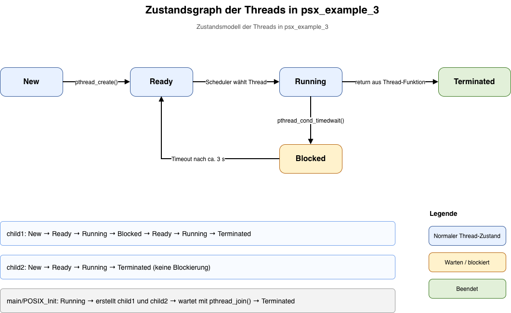
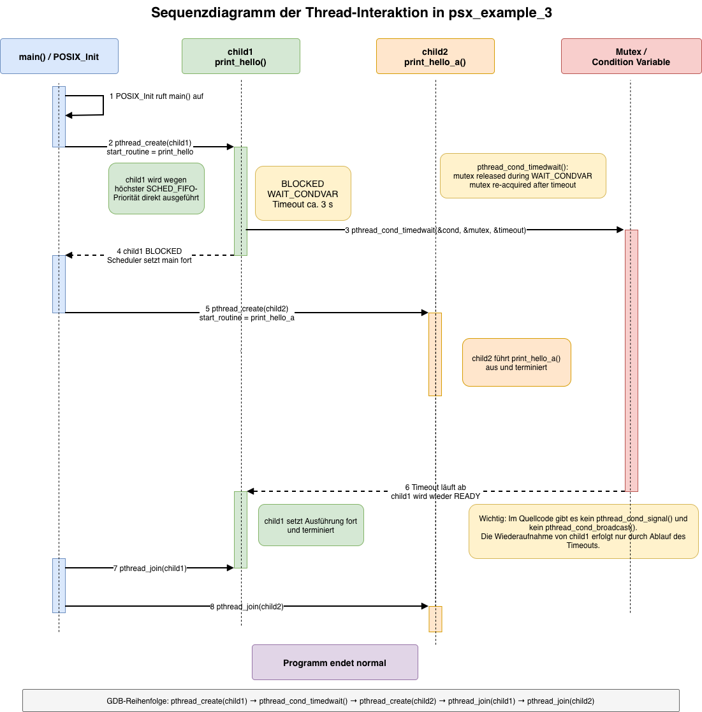
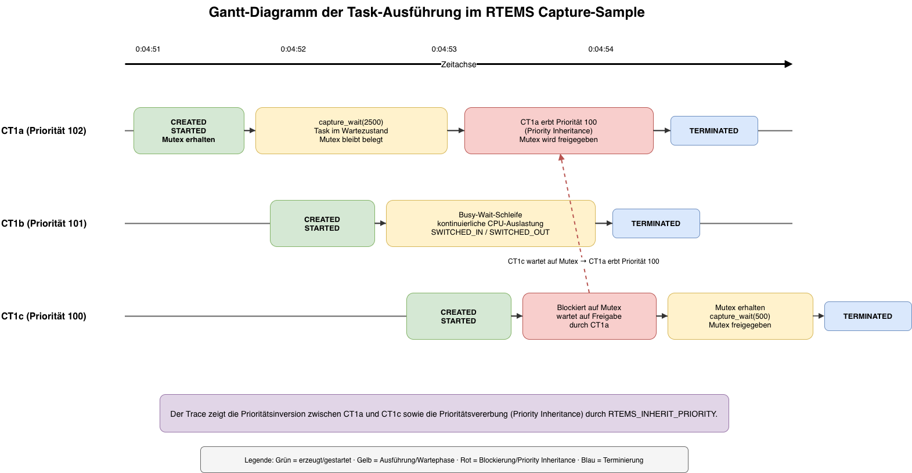

# RTEMS Real-Time Scheduling and Thread Analysis

An investigation of thread scheduling, synchronisation,
debugging and priority inheritance using RTEMS 7.

**Author:** Mazen Younis  
**Institution:** Berliner Hochschule für Technik (BHT)  
**Course:** Vertiefung Echtzeitsysteme  
**Year:** 2026

## Overview

This study investigates how a real-time operating system
schedules concurrent tasks and manages shared resources.

The experiments were conducted using RTEMS 7, QEMU,
GDB and the RTEMS Capture Engine.

Two RTEMS example applications were analysed:

1. `psx_example_3` — POSIX thread scheduling and synchronisation.
2. `capture` — Task scheduling, priority inversion and
   priority inheritance.

The work focuses on understanding and verifying the
behaviour of existing RTEMS examples rather than
developing a new scheduling algorithm.

## 1. POSIX Thread Scheduling

The `psx_example_3` application demonstrates
priority-based scheduling using POSIX threads.

The investigation covers:

- Thread creation with `pthread_create()`
- Priority-based scheduling using `SCHED_FIFO`
- Thread blocking through `pthread_cond_timedwait()`
- Synchronisation using `pthread_join()`
- Thread state transitions

The observed execution sequence was reconstructed
using source-code inspection and GDB debugging.

## 2. Dynamic Analysis with GDB

The application was executed under QEMU and examined
using the GNU Debugger.

Breakpoints were used to investigate:

- Thread creation
- Condition-variable waiting
- Thread execution order
- Thread termination and joining

The analysis compared the expected scheduling behaviour
with the observed runtime execution.

## 3. Priority Inversion and Priority Inheritance

The RTEMS Capture Engine was used to investigate
priority inversion in a three-task example.

The tasks have the following RTEMS priorities:

| Task | Priority | Role |
|---|---:|---|
| CT1a | 102 | Holds the shared mutex |
| CT1b | 101 | Intermediate-priority task |
| CT1c | 100 | Highest-priority task |

In the RTEMS Classic API, a lower numerical priority
represents a higher scheduling priority.

When CT1c attempts to acquire the mutex held by CT1a,
priority inversion occurs.

Priority inheritance temporarily raises CT1a's
effective priority from 102 to 100, allowing it
to execute and release the mutex.

The recorded execution traces demonstrate this
priority inheritance mechanism.

## 4. Experimental Evidence

The following diagrams document the scheduling behaviour,
thread interactions and priority inheritance mechanisms
investigated during the RTEMS laboratory experiments.

### 4.1 POSIX Thread State Diagram

The diagram illustrates the state transitions of the
two POSIX threads in the `psx_example_3` application.

The analysis focuses on:

- Thread creation and activation
- Transitions between ready and running states
- Blocking through `pthread_cond_timedwait()`
- Resuming execution after a timeout
- Thread termination

The state model was developed through source-code
analysis and verified against the observed execution
behaviour under RTEMS.

### 4.2 POSIX Thread Sequence Diagram

The sequence diagram reconstructs the interaction
between the main execution context and two child threads.

Under priority-based `SCHED_FIFO` scheduling:

1. The main thread creates `child1`.
2. `child1` begins executing with the highest priority.
3. `child1` blocks while waiting for a condition-variable timeout.
4. The main thread continues and creates `child2`.
5. `child2` executes and terminates.
6. Following the timeout, `child1` resumes execution.
7. The main thread uses `pthread_join()` to wait for termination.

The sequence was investigated using GDB breakpoints,
backtraces and thread inspection in QEMU.

### 4.3 Priority Inheritance — Scheduling Gantt Diagram

The Gantt diagram illustrates the scheduling behaviour
of three tasks in the RTEMS Capture Engine example.

The tasks have different priorities:

- `CT1a`: Priority 102 — initially holds the mutex.
- `CT1b`: Priority 101 — intermediate-priority task.
- `CT1c`: Priority 100 — highest-priority task.

When `CT1c` attempts to acquire the mutex held by
`CT1a`, it becomes blocked.

The RTEMS priority-inheritance mechanism temporarily
raises the effective priority of `CT1a` from 102 to 100.

This allows the mutex owner to execute and release
the shared resource, enabling the blocked higher-priority
task to continue.

The behaviour was reconstructed from RTEMS Capture Engine
execution traces.

### Experimental Scope

These diagrams document the analysis of existing
RTEMS example applications.

They demonstrate scheduling behaviour, thread
synchronisation and priority inheritance.

They do not constitute a formal verification of
real-time deadlines or worst-case execution times.

## 5. Key Learning Outcomes

This investigation demonstrates:

- Understanding of priority-based real-time scheduling
- Analysis of thread states and synchronisation
- Debugging embedded applications using GDB and QEMU
- Identification of priority inversion
- Interpretation of priority inheritance
- Analysis of recorded RTEMS scheduler events

## Scope

The scheduling experiments analyse RTEMS example
applications and their observed behaviour.

They complement the independently implemented
GPIO control application in this repository.

The experiments do not establish formal worst-case
execution-time or scheduling guarantees.
