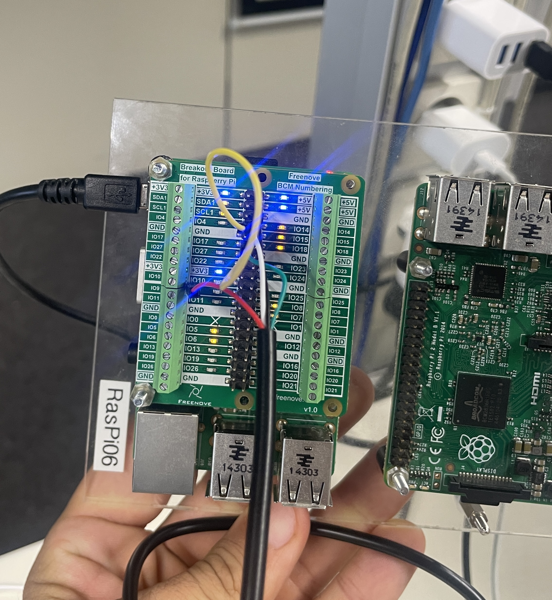
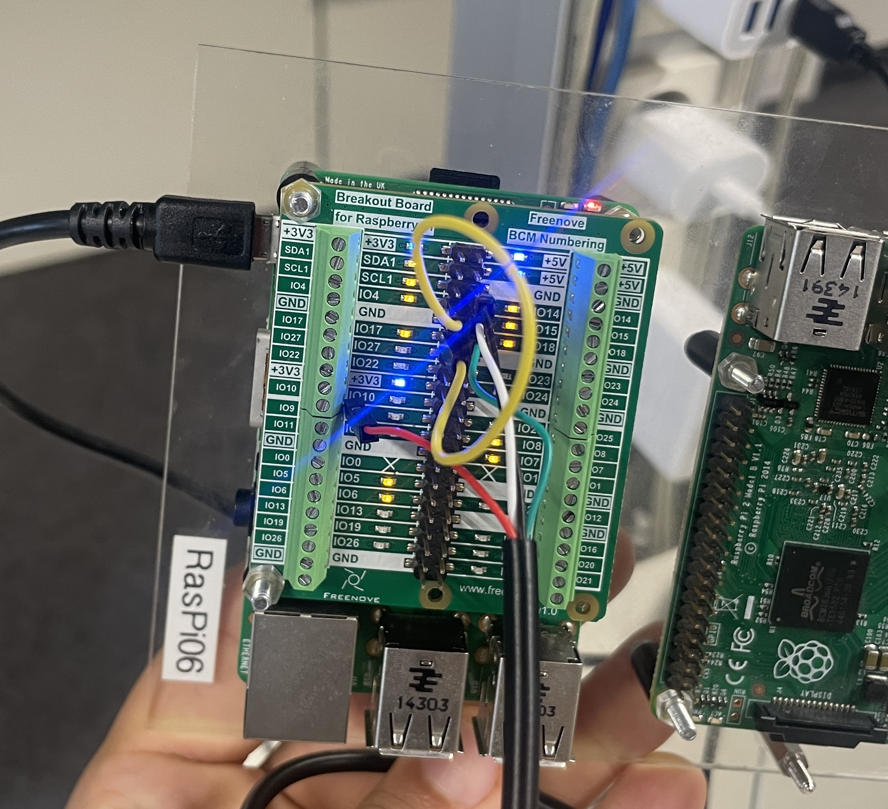
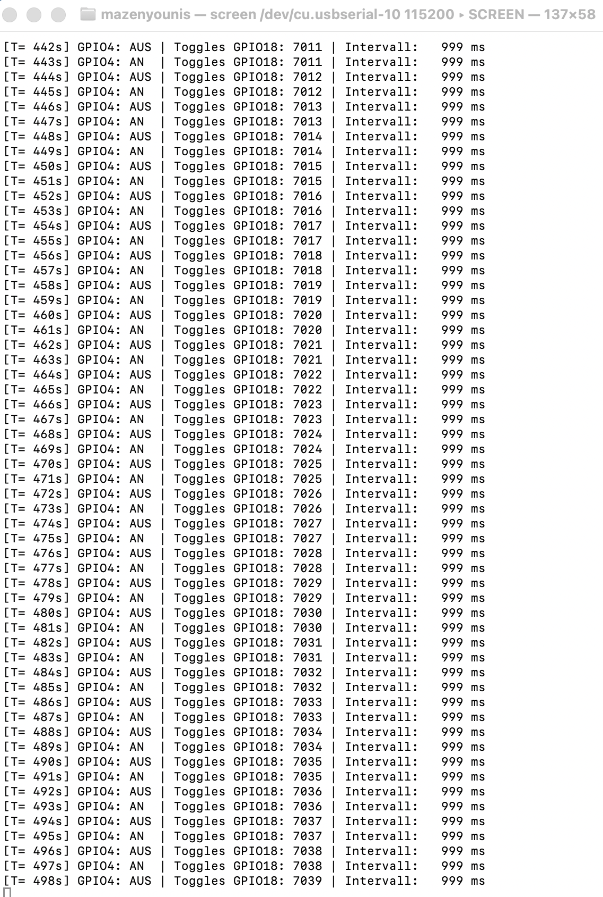
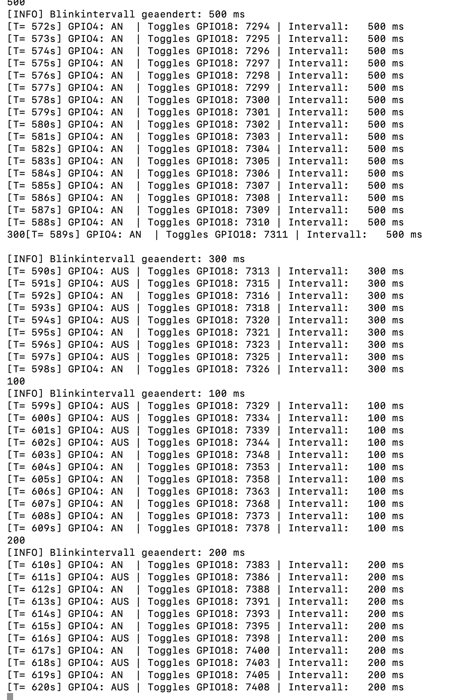

# RTEMS Embedded Control — Hardware Test Results

This directory contains selected photographs and terminal
screenshots documenting the RTEMS GPIO control application
developed for the Vertiefung Echtzeitsysteme course at
Berliner Hochschule für Technik (BHT).

## Hardware Environment

- Raspberry Pi
- Freenove GPIO Breakout Board
- RTEMS 7
- Serial console communication

## Functional Tests

The original laboratory experiments verified:

1. Periodic GPIO4 switching using a POSIX thread.
2. Falling-edge interrupt detection on GPIO17.
3. Interrupt-driven GPIO18 toggling.
4. Synchronisation using POSIX mutexes and semaphores.
5. Periodic status output through the serial console.
6. Runtime modification of the blinking interval.

## Experimental Evidence

The following photographs and terminal screenshots document
the original Raspberry Pi hardware experiments.

### 1. Raspberry Pi Hardware Setup

The test environment consists of a Raspberry Pi and a
Freenove GPIO breakout board.

GPIO4 is connected to GPIO17 through a jumper wire,
allowing falling-edge transitions to generate interrupts.

GPIO18 is controlled by a separate thread that responds
to interrupt events.

### 2. GPIO Operation on Physical Hardware

The photograph shows the physical test setup with
active GPIO indicators.

The application coordinates periodic GPIO switching
and interrupt-driven GPIO18 updates using POSIX threads
and synchronisation mechanisms.

### 3. Serial Console — Continuous Operation

The serial console displays the application's
operational state during execution.

The output includes:

- System uptime
- Current GPIO4 state
- Number of GPIO18 toggles
- Configured blinking interval

The captured output shows operation with a blinking
interval of approximately 999 ms.

### 4. Runtime Configuration Changes

The application supports changing the blinking
interval during execution without restarting RTEMS.

The recorded experiment demonstrates changes between
500 ms, 300 ms, 100 ms and 200 ms.

The serial output confirms that the updated values
were accepted and that GPIO18 continued responding
to generated interrupt events.

## Key Observation

The original experiments demonstrate that the
application successfully combines:

- Priority-based POSIX thread scheduling
- GPIO interrupt handling
- Semaphore-based event signalling
- Mutex-protected shared data
- Runtime configuration through the serial console

These results document functional behaviour on the
original hardware setup.

They do not establish measured interrupt latency,
worst-case execution times or formal hard real-time
deadline guarantees.

## Validation Scope

These results document the original laboratory tests
performed on Raspberry Pi hardware in 2026.

The source code published in this portfolio repository
includes subsequent corrections and has not been
independently revalidated on the physical hardware.

The experiments demonstrate functional behaviour,
not formally verified hard real-time timing guarantees.
